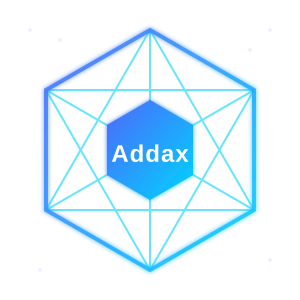
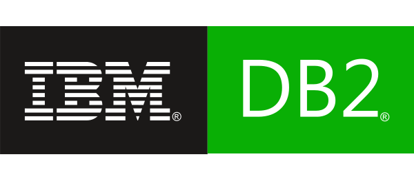
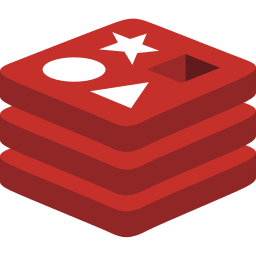
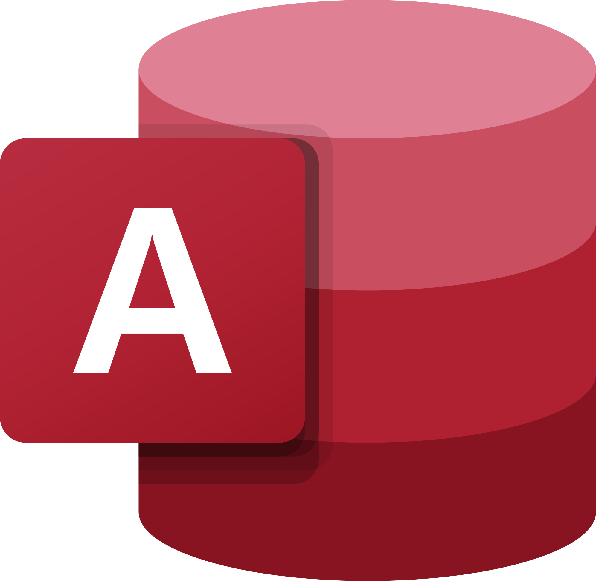

<p align="center">
    
</p>
<p align="center"><b>任意数据源，任意目标，就是快</b></p>
<p align="center"><a href="https://addax.wgzhao.com">使用文档</a> 详细描述了如何安装使用，针对每个插件都有详细的说明和样例配置文档 </p>
<p align="center">
   <a href="https://github.com/wgzhao/Addax/releases">
      
    </a>
   <a href="https://github.com/wgzhao/Addax/workflows/Maven%20Package/badge.svg">
       
   </a>
</p>

Addax 是阿里开源 [DataX](https://github.com/alibaba/datax) 的活跃维护继任者（DataX 官方仓库自 2023 年后已停止更新）—— 一个快速、通用的开源 ETL 工具，支持 30+ 关系型与非关系型数据源。在此基础上经过了大量的改进，持续活跃维护，并提供了更多的读写插件，详细情况可参考[与DataX的主要区别](difference.md)

<p align="center"><b>需要可视化界面？</b> 配套的 <a href="https://github.com/wgzhao/addax-admin"><b>Addax Admin</b></a> 是面向 T+1 ODS 采集的 Web 管理控制台，在同一个界面里完成采集表管理、调度执行、历史补数、数据对账与告警。</p>

## 项目状态

**Addax 处于积极的维护中。** 项目有意进入成熟的维护阶段：

- **月度维护版发布。** 大约每月发布一个新版本（见 [Releases](https://github.com/wgzhao/Addax/releases)），即使没有新特性，也会包含依赖/CVE 更新和 bug 修复。
- **及时的 issue 响应。** 已提交的 issue 通常在数天内得到回应和解决，而不是数月。
- **稳定是刻意的定位。** 插件功能刻意保持稳定：我们修复 bug、更新依赖，而不是追逐特性变动。新的数据源插件在有真实社区需求时才会添加——如果你需要，请[提交 issue](https://github.com/wgzhao/Addax/issues/new)。
- **欢迎贡献。** PR 持续被评审。参与方式见 [CONTRIBUTING.md](CONTRIBUTING.md)。

维护者请参阅 [RELEASING.md](RELEASING.md) 了解发布流程。

## 支持的数据库一览表

Addax 支持超过 30 种[关系型和非关系型数据库](support_data_sources.md)，通过简单的配置，还可以快速增加更多的数据源支持。

<table>
<tr>
<td></td>
<td></td>
<td></td>
<td></td>
</tr>
<tr>
<td></td>
<td></td>
<td></td>
<td></td>
</tr>
<tr>
<td></td>
<td></td>
<td></td>
<td></td>
</tr>
<tr>
<td></td>
<td></td>
<td></td>
<td></td>
</tr>
<tr>
<td></td>
<td></td>
<td></td>
<td></td>
</tr>
<tr>
<td></td>
<td></td>
<td></td>
<td></td>
</tr>
<tr>
<td></td>
<td></td>
<td></td>
<td></td>
</tr>
<tr>
<td></td>
<td></td>
<td></td>
<td></td>
</tr>
<tr>
<td></td>
<td></td>
</tr>
</table>

## 快速开始

### 使用 Docker 镜像

```shell
docker pull quay.io/wgzhao/addax:latest
docker run -ti --rm --name addax \
  quay.io/wgzhao/addax:latest \
  /opt/addax/bin/addax.sh /opt/addax/job/job.json
```

### 使用一键安装脚本

```shell
/bin/bash -c "$(curl -fsSL https://raw.githubusercontent.com/wgzhao/Addax/master/install.sh)"
```
上述脚本会将 Addax 安装到预设的目录( 对于 macOS Intel 而言，目录为 `/usr/local`,  Apple Silicon 以及 Linux 系统则为 `/opt/addax`)

### 编译及打包

目前编译需要 JDK 17 版本

```shell
git clone https://github.com/wgzhao/addax.git addax
cd addax
export MAVEN_OPTS="-DskipTests -Dmaven.javadoc.skip=true -Dmaven.source.skip=true -Dgpg.skip=true"
mvn clean package 
mvn package -Pdistribution
```

编译打包成功后，会在项目目录的`target` 目录下创建一个 `addax-<version>`的 文件夹，其中 `<version>` 表示版本。

### 开始第一个任务

发行版 `job/` 目录下有 30+ 个任务样本（多数同时提供 YAML 版本），其中 `job.json` 用作冒烟测试，进入发行版目录执行：

```shell
cd target/addax-<version>
bin/addax.sh job/job.json
```

该任务只搬 10 行生成数据，下面的耗时和速率仅用于确认任务跑通，不代表真实性能（见 [性能基准报告](PERFORMANCE.md)）。输出已省略中间日志，关键行如下：

```text
2026-11-26 17:18:58.839 [       job-0] INFO  JobContainer         - The Reader.Job [streamreader] perform prepare work .
2026-11-26 17:18:58.839 [       job-0] INFO  JobContainer         - The Writer.Job [streamwriter] perform prepare work .
2026-11-26 17:18:58.839 [       job-0] INFO  JobContainer         - Job set Channel-Number to 1 channel(s).
addax	19890604	1989-06-04 00:00:00	true	0x74657374
...
Job start  at             : 2026-11-26 17:18:58
Job end    at             : 2026-11-26 17:19:01
Job took secs             :                  3s
Total   bytes             :                 260
Average   bps             :               86B/s
Average   rps             :              3rec/s
Number of rec             :                  10
Failed record             :                   0
```

[这里](core/src/main/job) 以及[文档中心](https://github.com/wgzhao/addax-docs/tree/master/docs/public/assets/jobs) 提供了大量作业配置样例

## 运行要求

- JDK 17 or later
- Python 2.7+ / Python 3.7+ (Windows)

## 文档

- [在线文档](https://addax.wgzhao.com)
- [项目内文档](https://github.com/wgzhao/addax-docs)
- [性能基准报告](PERFORMANCE.md) — 2M 行 DB → HDFS / DB → DB 实测吞吐、测试方法与环境说明

## 代码风格

建议使用 IntelliJ 作为开发 IDE。项目的代码风格模板可以在[codestyle](https://github.com/airlift/codestyle)资源库中找到，还有我们的一般编程和Java指南。除了这些之外，你还应该遵守以下几点。

* 在文档源文件中按字母顺序排列章节（包括目录文件和其他常规文档文件）。一般来说，如果周围的代码中已经存在这样的排序，就按字母顺序排列方法/变量/部分。
* 在适当的时候，使用Java 8的流API。然而，请注意，流的实现并不是很好，所以避免在内循环或其他对性能敏感的部分使用它。
* 在抛出异常时对错误进行分类。例如，AddaxException 使用错误代码和错误消息作为参数，`AddaxException(REQUIRE_VALUE, "lack of required item")`。这种分类可以让你生成报告，这样你就可以监控各种故障。
* 确保所有文件都有适当的许可证头；你可以通过运行`mvn license:format`生成许可证。
* 考虑使用字符串格式化（使用Java`Formatter`类的printf风格）：`format("Session property %s is invalid: %s", name, value)`（注意，`format()`应该总是静态导入）。有时，如果你只需要附加一些东西，可以考虑使用`+`运算符。
* 除了琐碎的表达式，避免使用三元操作符。
* 如果有涵盖你的情况的断言，就使用Airlift的`Assertions`类，而不是手工写断言。
* 在编写Git提交信息时，请遵循这些[指南]（https://chris.beams.io/posts/git-commit/）。

## 版本命名规范

本项目遵循 [语义化版本规则](https://semver.org/lang/zh-CN/) 管理版本号，格式为 `x.y.z`，每个部分含义如下：

- **z（补丁版本）**:
  - 修复问题、性能优化等小改动，不影响现有功能的兼容性。
  - 示例: `1.2.3 → 1.2.4`

- **y（次要版本）**:
  - 添加新功能、模块调整，可能打破部分兼容性。
  - 示例: `1.2.3 → 1.3.0`

- **x（主要版本）**:
  - 引入重大变更或全新功能，大概率与前版本不兼容。
  - 示例: `1.3.0 → 2.0.0`

## Star History

<a href="https://www.star-history.com/?type=date&repos=wgzhao%2FAddax">
 <picture>
   <source media="(prefers-color-scheme: dark)" srcset="https://api.star-history.com/chart?repos=wgzhao/Addax&type=date&theme=dark&legend=top-left&sealed_token=jmRwqY8lGtF59oVMCKpMzTA2yQHsU05z7ZovIgr_ynaROhApg1ZXRB87dPOm0m4igVW55GHeoXEIz7McZxpp5p_Nf54WwhRQNOzee9pX4co8fvEiGpfeklAM2mM3Q1LjqfOK8IFCNIQxfN5G_CU_KyYpNFbxeIPBarkG22jmvL6T0QO15VXsq2N63CJs" />
   <source media="(prefers-color-scheme: light)" srcset="https://api.star-history.com/chart?repos=wgzhao/Addax&type=date&legend=top-left&sealed_token=jmRwqY8lGtF59oVMCKpMzTA2yQHsU05z7ZovIgr_ynaROhApg1ZXRB87dPOm0m4igVW55GHeoXEIz7McZxpp5p_Nf54WwhRQNOzee9pX4co8fvEiGpfeklAM2mM3Q1LjqfOK8IFCNIQxfN5G_CU_KyYpNFbxeIPBarkG22jmvL6T0QO15VXsq2N63CJs" />
   
 </picture>
</a>

## 代码授权许可

该软件在遵守 [Apache license](/license.txt) 下可自由免费使用

## 特别感谢

特别感谢 [JetBrains](https://jb.gg/OpenSource) 对本项目提供开发工具赞助
